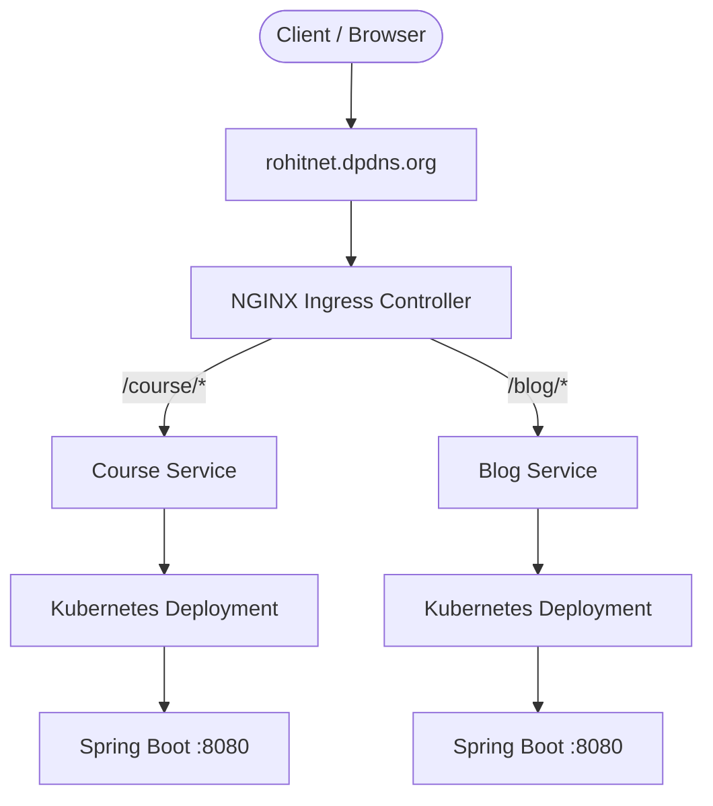

# 🚀 Kubernetes Microservices – Ingress Demo

<p align="center">
  <b>One Domain. Multiple Microservices. One Kubernetes Cluster.</b>
</p>

<p align="center">
  
  
  
  
  
</p>

---

## ✨ About the Project

A hands-on microservices project demonstrating how multiple independent Spring Boot applications can be containerized, deployed, and exposed through a **single domain using Kubernetes and NGINX Ingress**.

Instead of exposing every microservice separately, NGINX Ingress intelligently routes incoming requests based on URL paths.

**Two services. One entry point. Clean routing.**

## 🏗️ Architecture



<details>
<summary>🔍 How routing works</summary>

| Incoming Request | Backend Service | Forwarded Endpoint |
|---|---|---|
| `/course/allCourses` | Course Service | `/allCourses` |
| `/blog/allBlogs` | Blog Service | `/allBlogs` |

NGINX Ingress removes the `/course` or `/blog` prefix using URL rewriting before forwarding the request.

</details>

## 🛠️ Tech Stack

| Technology | Role |
|---|---|
| ☕ Java 21 | Application development |
| 🌱 Spring Boot 3.3.2 | REST APIs |
| 📦 Maven | Build and dependency management |
| 🐳 Docker | Containerization |
| ☸️ Kubernetes | Deployment and orchestration |
| ⚡ Minikube | Local Kubernetes environment |
| 🌐 NGINX Ingress | Path-based routing |
| 📤 Docker Hub | Image registry |

## 📦 Microservices

<details open>
<summary><b>📚 Course Service</b></summary>

Provides a REST endpoint to retrieve available courses.

**API**

`GET /allCourses`

**Sample Response**

```json
[
  {
    "courseId": "C001",
    "name": "Java Basics",
    "price": 199.99
  },
  {
    "courseId": "C002",
    "name": "Spring Boot Mastery",
    "price": 299.99
  }
]
```

**Docker Image:** `callmee6/course-service:1.1`

</details>

<details open>
<summary><b>📝 Blog Service</b></summary>

Provides a REST endpoint to retrieve available blog articles.

**API**

`GET /allBlogs`

**Sample Response**

```json
[
  {
    "id": "B001",
    "title": "The Magic of Java Streams",
    "content": "An in-depth exploration of Java Streams and their use cases.",
    "author": "Alice"
  }
]
```

**Docker Image:** `callmee6/blog-service:1.1`

</details>

## 🐳 Docker – Build & Push

Each microservice is packaged as an executable Spring Boot JAR and bundled into a Docker image using Eclipse Temurin Java 21.

**Course Service**

```bash
cd course-service

mvn clean package

docker build -t callmee6/course-service:1.1 .
docker push callmee6/course-service:1.1
```

**Blog Service**

```bash
cd blog-service

mvn clean package

docker build -t callmee6/blog-service:1.1 .
docker push callmee6/blog-service:1.1
```

## ☸️ Kubernetes Deployment

Each microservice runs independently with:

- **Deployment:** 1 replica
- **Service Type:** ClusterIP
- **Service Port:** 80
- **Container Port:** 8080

### Deploy the applications

```bash
kubectl apply -f course-service.yaml
kubectl apply -f blog-service.yaml
```

### Configure Ingress

Apply the routing configuration:

```bash
kubectl apply -f ingress.yaml
```

### Verify the deployment

```bash
kubectl get deployments
kubectl get pods
kubectl get services
kubectl get ingress
```

## 🌐 Ingress – Single Domain, Multiple Services

**Application Domain**

`http://rohitnet.dpdns.org`

The Ingress resource uses path-based routing to direct traffic to the appropriate backend.

| Route | Destination |
|---|---|
| `/course/*` | `course-service:80` |
| `/blog/*` | `blog-service:80` |

### Local Domain Mapping

For local Minikube testing, add the following entry to `/etc/hosts`:

```text
192.168.49.2 rohitnet.dpdns.org
```

Edit the file:

```bash
sudo nano /etc/hosts
```

> Replace the IP if your Minikube cluster uses a different address.

## 🧪 API Testing

Try the live routes from your configured local environment:

**📚 Get All Courses**

```bash
curl http://rohitnet.dpdns.org/course/allCourses
```

**📝 Get All Blogs**

```bash
curl http://rohitnet.dpdns.org/blog/allBlogs
```

Both endpoints should return JSON responses from their respective microservices.

## 🔧 Useful Kubernetes Commands

| Task | Command |
|---|---|
| View all resources | `kubectl get all` |
| View pods | `kubectl get pods` |
| View services | `kubectl get svc` |
| View Ingress | `kubectl get ingress` |
| Course logs | `kubectl logs deployment/course-service-deployment` |
| Blog logs | `kubectl logs deployment/blog-service-deployment` |

**Restart services**

```bash
kubectl rollout restart deployment/course-service-deployment
kubectl rollout restart deployment/blog-service-deployment
```

**Check rollout status**

```bash
kubectl rollout status deployment/course-service-deployment
kubectl rollout status deployment/blog-service-deployment
```

**Apply all configurations**

```bash
kubectl apply -f course-service.yaml
kubectl apply -f blog-service.yaml
kubectl apply -f ingress.yaml
```

## 💡 What I Learned

- Building RESTful microservices with Spring Boot.
- Packaging executable JARs using Maven.
- Creating and publishing Docker images.
- Deploying independent services on Kubernetes.
- Understanding Deployments, Pods, and ClusterIP Services.
- Configuring NGINX Ingress and path-based routing.
- Implementing URL rewriting for microservice endpoints.
- Troubleshooting container startup and Kubernetes rollout issues.

## 🔮 Future Enhancements

- [ ] Externalize configuration using ConfigMaps.
- [ ] Secure credentials using Kubernetes Secrets.
- [ ] Add readiness and liveness probes.
- [ ] Configure Horizontal Pod Autoscaling.
- [ ] Enable HTTPS using TLS.
- [ ] Automate builds and deployments using Jenkins CI/CD.
- [ ] Integrate persistent database storage.

---

<p align="center">
  <b>Built with ☕ Java, 🐳 Docker & ☸️ Kubernetes</b>
  <br/>
  <sub>Developed by <b>Rohit Sarla</b></sub>
</p>
